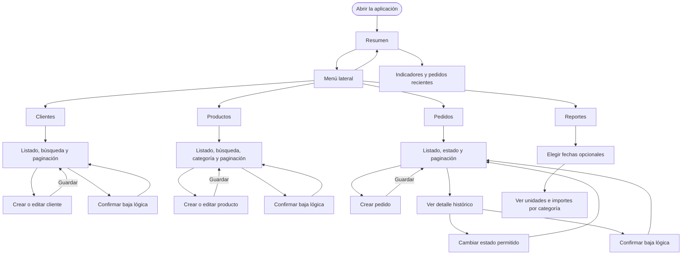
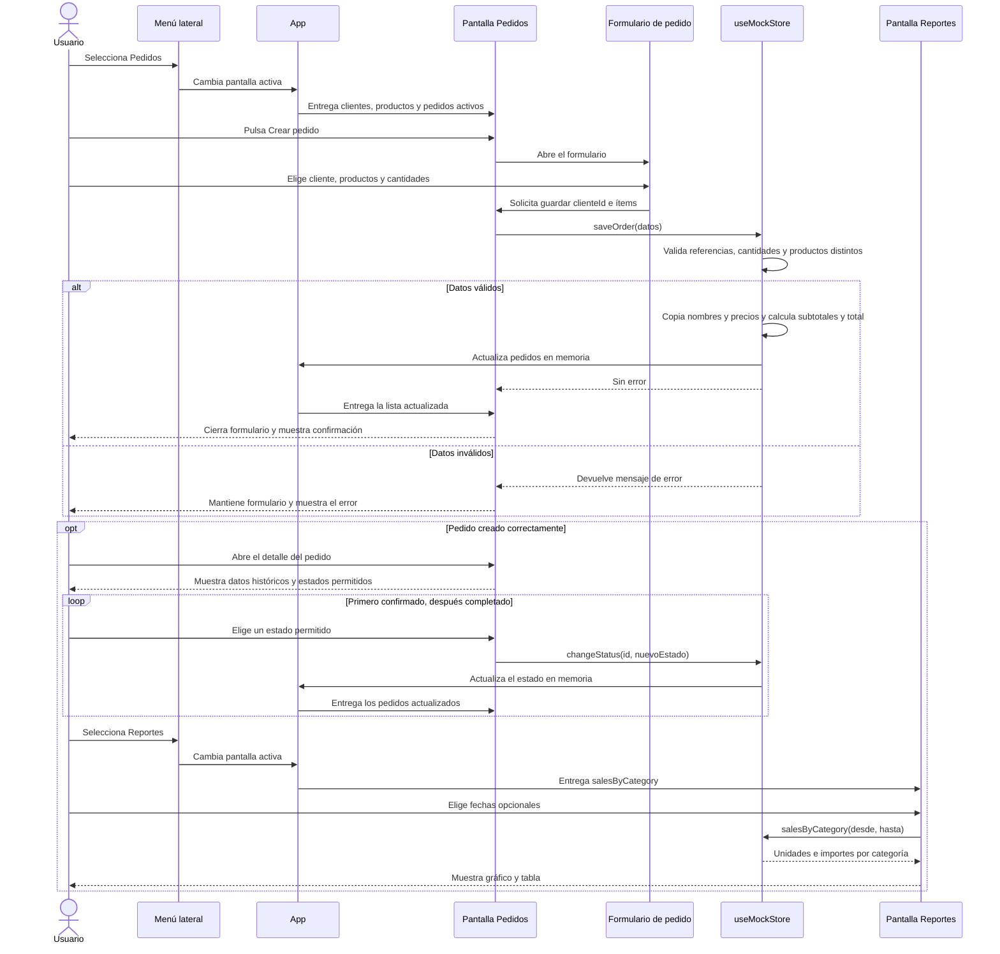

# Uso del frontend

Esta guía describe el **prototipo actual**. La navegación cambia la pantalla visible dentro de React; no cambia la URL. Los datos iniciales y todas las modificaciones viven en memoria en `useMockStore`. Por ahora no hay solicitudes HTTP, backend ni base de datos en este recorrido. Al recargar el navegador, vuelven los datos de ejemplo.

## Flujo de pantallas

El menú lateral está disponible desde todas las pantallas. En móvil se abre con el botón del menú y se cierra al elegir una sección.

**Resumen** muestra los conteos activos, el importe de pedidos completados y los pedidos recientes. **Clientes** y **Productos** permiten crear, editar y dar de baja; la baja oculta el registro de los listados activos. **Pedidos** permite crear, consultar el detalle, avanzar de estado o dar de baja. Cancelar un pedido es un cambio de estado y no equivale a darlo de baja. **Reportes** agrupa los ítems históricos de pedidos activos y completados, con fechas opcionales.

## Secuencia de uso: crear un pedido y verlo en el reporte

Este ejemplo muestra cómo colaboran las pantallas y el store mock. `App` conserva el estado general y entrega a cada pantalla los datos y operaciones que necesita.

El formulario enseña un **total estimado** antes de guardar. El mock vuelve a calcularlo al crear el pedido y guarda una copia de los datos del cliente y de cada producto. Por eso el detalle conserva nombres y precios anteriores aunque luego se edite o dé de baja un producto. Un pedido aparece en el reporte cuando está **activo**, tiene estado **completado** y su fecha de creación entra en el período elegido.

## Dónde está implementado

| Parte | Archivo |
| --- | --- |
| Selección de pantalla y composición | [`src/app.tsx`](src/app.tsx) |
| Menú lateral | [`src/components/layout/app-shell.tsx`](src/components/layout/app-shell.tsx) |
| Datos y operaciones del mock | [`src/mocks/data.ts`](src/mocks/data.ts), [`src/mocks/useMockStore.ts`](src/mocks/useMockStore.ts) |
| Pantalla y formulario de pedidos | [`src/pages/orders-page.tsx`](src/pages/orders-page.tsx), [`src/components/forms/order-form.tsx`](src/components/forms/order-form.tsx) |
| Pantalla de reportes | [`src/pages/reports-page.tsx`](src/pages/reports-page.tsx) |
